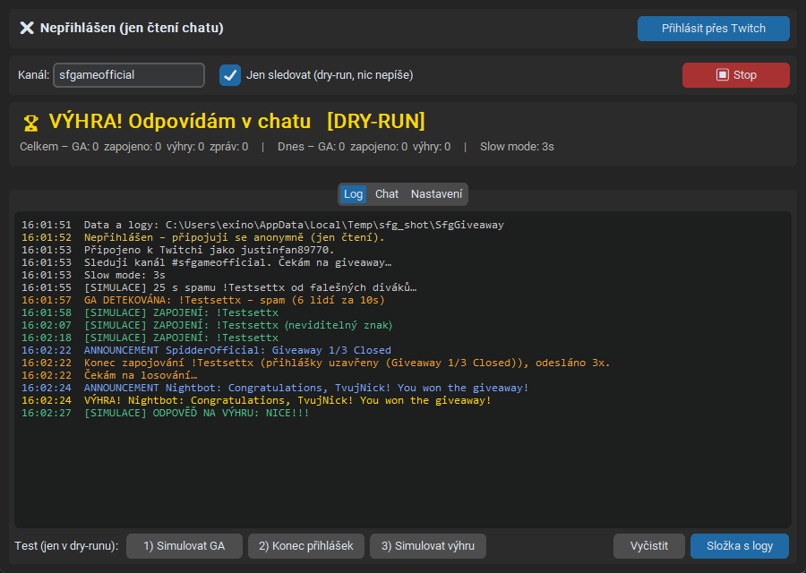

# SFGame Giveaway Joiner

Windows appka, která hlídá chat **[twitch.tv/sfgameofficial](https://twitch.tv/sfgameofficial)**,
pozná giveaway podle spamu `!slova`, sama se zapojí a když tě vylosují, do pár sekund odpoví v chatu,
aby výhra nepropadla.



## Stažení a použití

1. Stáhni **`SfgGiveaway.exe`** z [Releases](https://github.com/KubaLooop/sfgame-giveaway-joiner/releases/latest).
2. Spusť ho. SmartScreen může varovat „neznámý vydavatel“ → *Další informace → Přesto spustit*.
3. **Přihlásit přes Twitch** → potvrď kód na twitch.tv/activate (jednou, token se obnovuje sám).
4. Nech zaškrtnuté **Jen sledovat (dry-run)**, dej **Start** a vyzkoušej tlačítka simulace.
5. Odškrtni dry-run → appka píše naostro.

Podrobný návod pro neprogramátory na jednu stránku: **[docs/Navod.pdf](docs/Navod.pdf)**.

## Jak to funguje

| Fáze | Co appka sleduje | Co udělá |
|---|---|---|
| **Start GA** | ≥ 6 různých lidí napíše stejné `!slovo` během 10 s (nebo mod/streamer + 2 lidi) | začne se zapojovat |
| **Zapojení** | – | ~7 zpráv `!slovo` rovnoměrně během minuty, vždy nad slow mode |
| **Podvrh / změna slova** | chat začne spamovat jiné `!slovo` | zapojí se i do nového (má přednost), staré opustí, když ho přestanou spamovat |
| **Konec přihlášek** | announcement `Giveaway X/Y Closed` | přestane psát, čeká na losování |
| **Výhra** | announcement Nightbota `Congratulations, <nick>! You won the giveaway!` (kdykoliv, i bez zapojení) | po 1–3 s náhodná fráze z `phrases.txt`, za ~5 s druhá |

- Běžné příkazy (`!discord`, `!rules`…) se ignorují; nové se appka učí sama, když na ně odpoví Nightbot/StreamElements.
- Nick se porovnává bez ohledu na velikost písmen (`CoolViewer` = `coolviewer`).
- Twitch zahazuje stejnou zprávu do 30 s → opakovaná zpráva dostane na konec neviditelný znak.
- Při timeoutu / banu přestane psát.
- Statistiky (celkem i po dnech), přihlášení a nastavení přežijí restart.

Data: `%APPDATA%\SfgGiveaway\` – `config.json`, `stats.json`, `phrases.txt`, `learned_commands.json`,
`token.json` a `logs\` (denní log událostí + volitelně raw chat pro ladění).

> ⚠️ Automatické zapojování může být proti pravidlům giveawaye a moderátoři za to můžou dát timeout/ban.
> Používej na vlastní riziko.

## Vývoj

```bash
pip install -r requirements.txt pytest
python -m pytest tests            # detekce, stavový automat, perzistence
python run.py                     # GUI
python run.py --cli               # bez GUI, dry-run v konzoli (--live = naostro)
python run.py --replay "%APPDATA%\SfgGiveaway\logs\raw-2026-11-09.log" --nick mujnick
```

`--replay` přehraje nahraný raw chat přes detekci a vypíše, co by appka poslala a kdy –
ideální na ladění podle skutečné GA.

### Struktura

```
app/
  irc.py        parser Twitch IRC (IRCv3 tagy) -> ChatEvent
  detector.py   čistá logika: start GA, výhra, konec, učení commandů
  engine.py     stavový automat + plánování zpráv (bez I/O, řízený časem)
  bot.py        WebSocket spojení, reconnect, odesílání, simulace
  auth.py       Twitch OAuth device-code flow (public client)
  gui.py        CustomTkinter okno (Log / Chat / Nastavení)
  stats.py      trvalé statistiky
  replay.py     přehrávání raw logu
docs/           návod PDF + jeho generátor
```

### Build exe

Na Windows s Pythonem 3.12+: `build.bat` → `dist\SfgGiveaway.exe`.

### Vlastní Twitch aplikace

Appka používá Client ID z `app/config.py` (aplikace typu **Public**, Client ID není tajné).
Vlastní si zaregistruješ na [dev.twitch.tv/console/apps](https://dev.twitch.tv/console/apps) –
redirect `http://localhost`, kategorie *Chat Bot*, Client Type *Public*.

### Návod PDF

`python docs/build_guide.py` (potřebuje `reportlab` a fonty Segoe UI z Windows).
